# ClubConnect: Club Event Management & Registration System

> DBMS (UE23CS351A) Experiential Learning, Level 3 mini project, PES University, Aug–Dec 2026
> Department of Computer Science and Engineering (AI & ML), B.Tech 5th semester

ClubConnect replaces the chat groups, spreadsheets and e-mails that student clubs use to run events. A club drafts an event, a campus administrator approves it (the **database itself refuses** to approve two events that overlap in one venue), students find it in a catalogue or calendar and register, and the club manages participants and attendance. Every step creates notifications and an audit trail.

| | |
|---|---|
| **Team** | Dhriti Kamani (PES1UG24AM085), Disha Lokesh (PES1UG24AM093) |
| **Section** | B |
| **Faculty** | Prof. Smitha |
| **Repository** | https://github.com/disha-lokesh/ClubConnect |

---

## Contents

1. [Features](#1-features)
2. [Tech stack and why](#2-tech-stack-and-why)
3. [Architecture](#3-architecture)
4. [Database design](#4-database-design)
5. [Security and role-based access control](#5-security-and-role-based-access-control)
6. [Results and screenshots](#6-results-and-screenshots)
7. [Getting started](#7-getting-started)
8. [Demo accounts and demo script](#8-demo-accounts-and-demo-script)
9. [Testing and verification](#9-testing-and-verification)
10. [Evaluation rubric mapping](#10-evaluation-rubric-mapping)
11. [Project structure](#11-project-structure)
12. [Design decisions, limitations and future work](#12-design-decisions-limitations-and-future-work)
13. [Team contributions and declaration](#13-team-contributions-and-declaration)

---

## 1. Features

Three account roles, each with its own area of the app.

### Student
- Sign up (the role is fixed to student) and log in.
- **Event catalogue** with filters (club, category *including sub-categories*, date range, maximum fee, open-for-registration only) and full-text search that matches word prefixes.
- **Calendar** view of published events.
- **Register / cancel.** Registration is instant, or *pending* until the club approves when the event needs manual approval. The system refuses full events, passed deadlines, duplicates and members-only events for non-members. Cancelling frees the seat.
- My registrations, participation history, join/leave clubs, notifications, profile.
- Leave **feedback** after attending an event (MongoDB).

### Club administrator
- Create and edit **draft** events (venue, time, deadline, capacity, fee, eligibility, manual approval); see **venue-clash warnings** before submitting.
- **Submit** for approval, withdraw, reopen a rejected event, or **cancel** an approved one (all live registrations are cancelled and students notified).
- Approve/reject pending registrations, view participants, **mark attendance** (only for confirmed registrations, only after the event starts).
- Post, pin, edit and delete **announcements** on own events (MongoDB); read anonymised feedback.
- Club dashboard, calendar and report. A club admin can only touch their own club's data and **cannot approve their own event**.

### Campus administrator
- **Approvals queue**: approve, or reject with a mandatory reason.
- **Venue-conflict monitor**; all-events view and calendar.
- Manage clubs, venues (deactivate), category tree, and create club-admin / campus-admin accounts.
- **Reports**: SQL (joins, GROUP BY/HAVING, recursive CTE, correlated subquery, window function) and MongoDB aggregation pipelines.
- **Activity log** (MongoDB) with filtering and purge.

### Built into the database
- Notifications created by **triggers** in the same transaction as the change.
- **Audit trail** of every event status change (`event_status_history`).
- **Concurrency-safe seat booking**: two students racing for the last seat can never over-book.
- Legal status transitions enforced by triggers; venue double-booking prevented by an **exclusion constraint**.

---

## 2. Tech stack and why

| Layer | Technology | Why |
|---|---|---|
| Front end + API | **Next.js 16** (App Router), **React 19**, **TypeScript 5.9**, Node 22 | Required by the brief; server components read data directly and route handlers form the REST API; one language end to end |
| Relational DB | **PostgreSQL 16** | System of record. ACID transactions, joins, exclusion constraints, row-level security, SECURITY DEFINER functions, generated columns, recursive CTEs, full-text search |
| Document DB | **MongoDB** (driver 7.x) | Flexible, append-only or aggregated data: announcements, feedback, activity log |
| Libraries | `pg`, `mongodb`, **Zod** (validation), **bcryptjs** (passwords), **jose** (JWT sessions) | Thin drivers, **no ORM**: every SQL statement is visible and explainable |
| Styling | Hand-written CSS | No UI framework dependency |

> This is **not** a MERN stack: the main database is PostgreSQL, and Next.js route handlers replace Express. It is a *polyglot persistence* design.

**Rule used to split the data:** things that need joins, constraints and multi-row transactions (users, events, registrations, seats, approvals, notifications) live in PostgreSQL. Flexible, high-volume or aggregated data (announcements, feedback, logs) lives in MongoDB.

---

## 3. Architecture

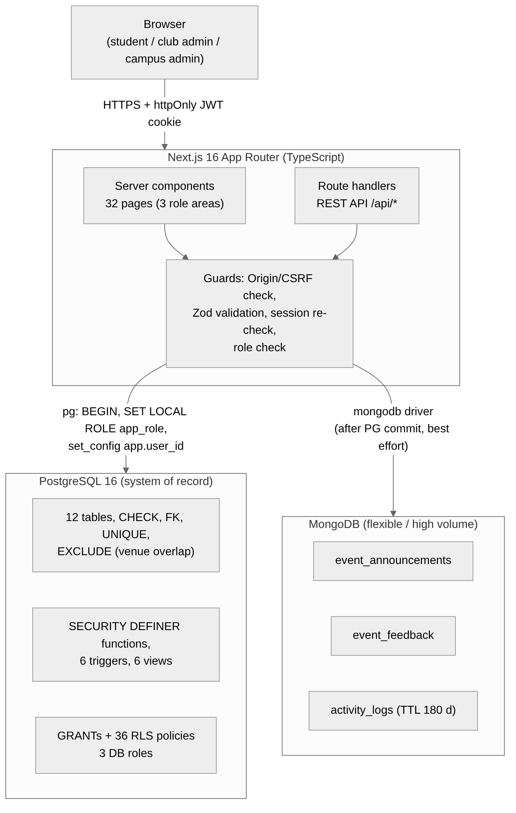

Request lifecycle for every state-changing API call:

1. Origin check (CSRF defence in depth) and request body validated with Zod.
2. Signed JWT session cookie verified, then the user is **re-checked in PostgreSQL** (a deactivated user is locked out on the next request).
3. Role check in the API (fast fail).
4. `BEGIN; SET LOCAL ROLE app_<role>; set_config('app.user_id', …)`: the **database now acts as that user**.
5. SQL / stored function runs under that role: GRANTs, column privileges, row-level security and function checks apply.
6. `COMMIT`, then a best-effort MongoDB activity-log write that can never fail the request.

There are no distributed transactions: PostgreSQL commits first; events are never hard-deleted, so MongoDB references cannot dangle; if MongoDB is down only the Mongo-backed sections show a notice.

---

## 4. Database design

### 4.1 PostgreSQL (12 tables)

**Figure 1: ER diagram of ClubConnect** (hand-drawn, Chen notation; the original conceptual design)

Figure 1: ER diagram of ClubConnect 


`users`, `students`, `clubs`, `club_admins`, `club_members`, `event_categories` (self-referencing tree), `venues`, `events`, `event_status_history` (weak), `registrations`, `attendance` (weak entity), `notifications`.

**Relational schema diagram** (PK/FK links between the 12 tables of the final implementation)

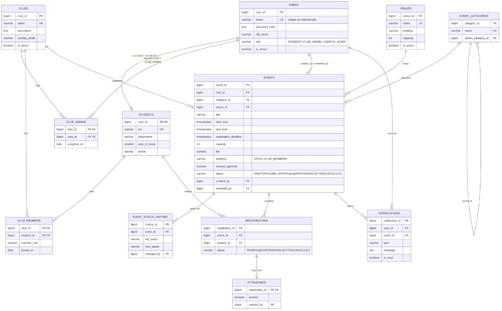

Highlights (all in `db/migrations/`):

| Concept | Where / how |
|---|---|
| Keys & constraints | PK/FK/UNIQUE/CHECK on every table; unique index on `lower(email)`; one registration per student per event (`UNIQUE (event_id, student_id)`) |
| Role-pinned foreign keys | Generated `role` column + composite FK, so a `students` row can only point at a STUDENT account |
| **Exclusion constraint** | `EXCLUDE USING gist (venue_id WITH =, tstzrange(start_time,end_time,'[)') WITH &&) WHERE (status='APPROVED')`: back-to-back events allowed, overlaps impossible |
| Derived data not stored | Seats taken / left come from `seats_taken()` / `available_seats()`, not a counter that could drift |
| Normalisation | 3NF (see `docs/02-er-and-relational-schema.md`) |
| **Functions** (`SECURITY DEFINER`) | `register_for_event`, `cancel_registration`, `decide_registration`, `submit_event`, `reopen_event`, `review_event`, `cancel_event`, `mark_attendance`, `event_summary`, `check_event_conflicts`, `seats_taken`, `available_seats`, `is_club_admin_of`, `authenticate_lookup`, `register_student`, `create_staff_user`, `session_check` and helpers |
| **Triggers** (6) | `events_validate`, `events_history`, `events_notify`, `registrations_guard`, `registrations_notify`, `attendance_guard` |
| **Views** (6) | `published_events`, `event_registration_summary`, `venue_conflicts`, `student_participation_history`, `club_participants`, `category_tree` (recursive) |
| Indexes | B-tree for lookups, **GIN** on a generated `tsvector` for full-text search, GiST for the exclusion constraint |
| Concurrency | `register_for_event` locks the event row (`SELECT … FOR UPDATE`) before counting seats and inserting |
| Queries | Joins, GROUP BY/HAVING, IN / NOT EXISTS, correlated subquery, recursive CTE, window functions, INTERSECT, full-text ranking: `db/demo/03_queries.sql` |

### 4.2 MongoDB (3 collections)

| Collection | Purpose | Notable features |
|---|---|---|
| `event_announcements` | Club posts on a published event | Full CRUD, pinned flag, free tags, `$jsonSchema` validator |
| `event_feedback` | One review per attended student | **Unique** `(eventId, studentUserId)`, upsert, ratings validated 1–5, anonymised for clubs |
| `activity_logs` | Append-only audit trail | **TTL index** (180 days), flexible `metadata` |

Aggregation pipelines (`src/lib/mongo-pipelines.mjs`): average rating per event (`$group`, `$avg`, `$cond`), tag counts (`$unwind`), activity per day (`$dateToString`), most active users (`$max`), announcements per club.

Details: `docs/03-mongodb-model.md`.

---

## 5. Security and role-based access control

Access control is enforced **inside PostgreSQL**, not only in the API.

- **Three database roles**: `app_student`, `app_club_admin`, `app_campus_admin` (NOLOGIN). The app logs in as one restricted role (`clubconnect_app`, no privileges of its own) and uses `SET LOCAL ROLE` per transaction.
- **Table and column GRANTs.** Nobody can read `users.password_hash`; a club admin can edit descriptive event columns but **cannot write `events.status`**.
- **36 row-level-security policies.** Students see only published events (plus cancelled ones they registered for), their own registrations and notifications; club admins see their own clubs' drafts and participants; campus admins see everything except drafts.
- `EXECUTE` on every function is revoked from `PUBLIC` and granted per role; each function re-checks role and ownership and raises typed errors (`CC403/404/409/422`) that the API maps to HTTP codes.
- **Authentication**: bcrypt (cost 10), identical error for unknown e-mail and wrong password, login throttle, 8-hour `httpOnly` `SameSite=Lax` JWT cookie re-validated in the database on every request, public sign-up can only create students.
- Parameterised SQL everywhere, Zod validation on every body, no `dangerouslySetInnerHTML`, error responses never leak SQL or stack traces.

Proof: `docs/outputs/05_rbac.txt` (SQL run directly as each role) and the RBAC tests below.

---

## 6. Results and screenshots

### Resulting tables' screenshots

**Screenshot: users table**

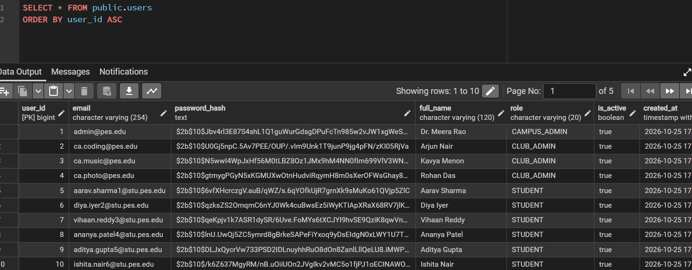

**Screenshot: events table with APPROVED / PENDING rows**

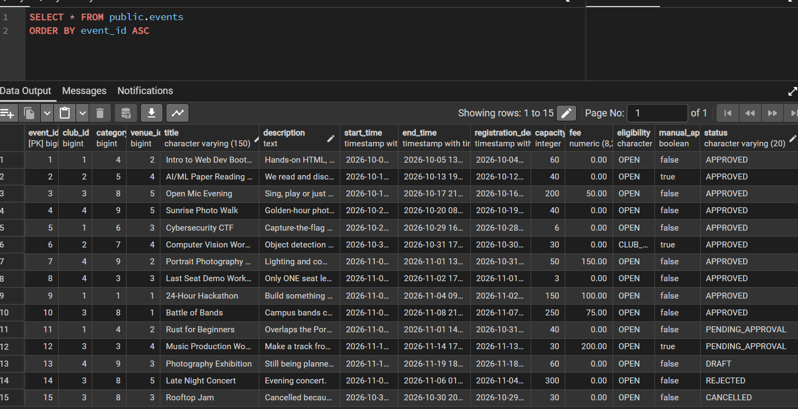

**Screenshot: Exclusion-constraint error when approving overlapping events**

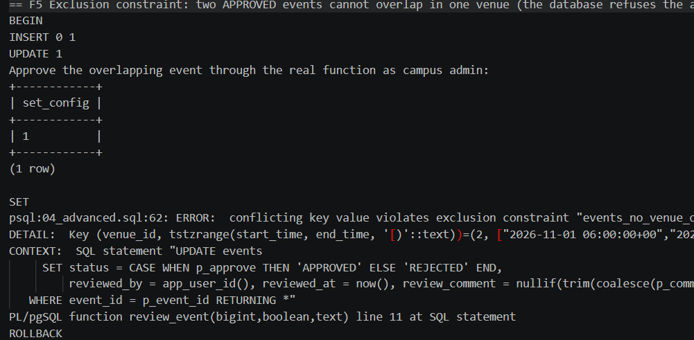

**Screenshot: Last-seat race: student B rejected (04_advanced.sql F2)**

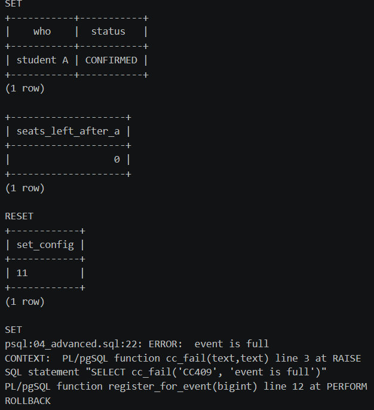

**Screenshot: MongoDB Compass: event_announcements, event_feedback, activity_logs**

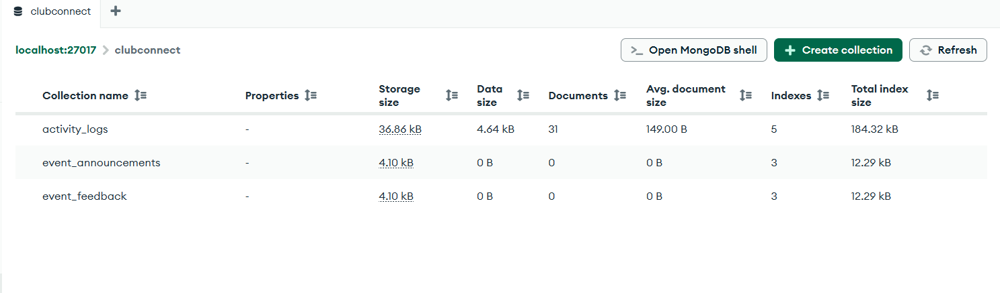

### Sample screenshots of the application

**Screenshot: Login and registration page**

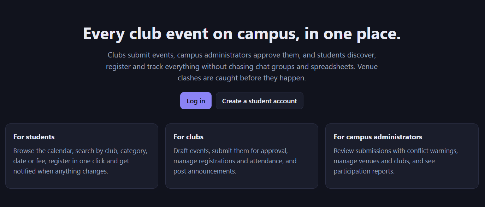

**Screenshot: Student: event catalogue with search and filters**

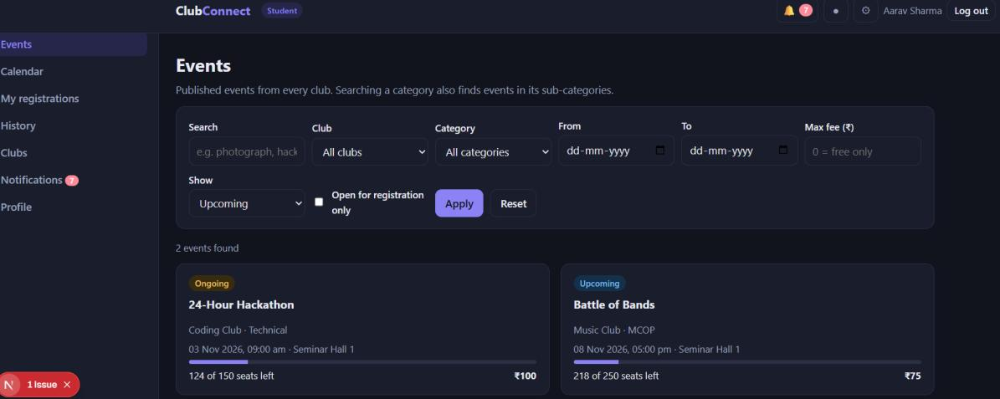

**Screenshot: Student: calendar**

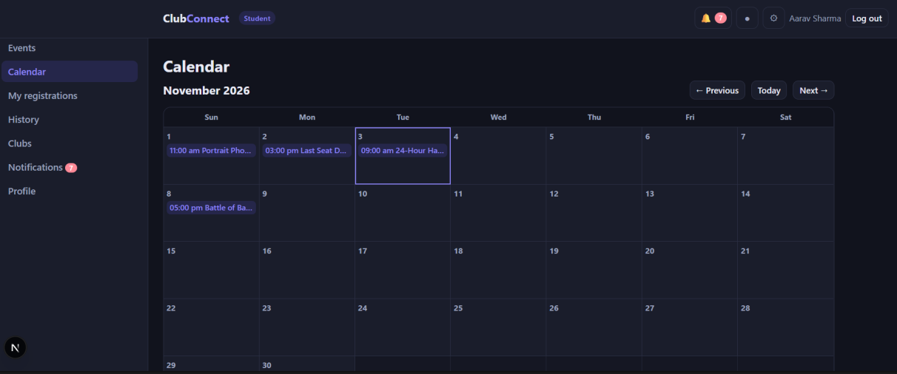

**Screenshot: Club admin: my events page**

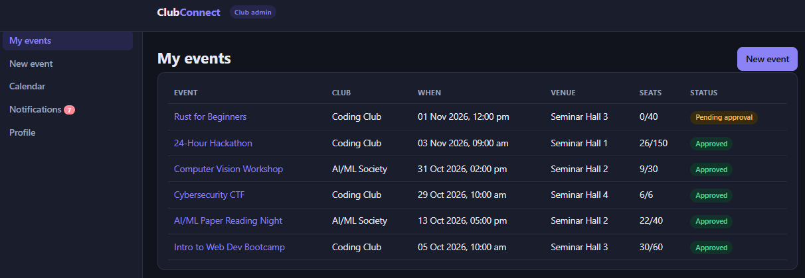

**Screenshot: Club admin: creating an event**

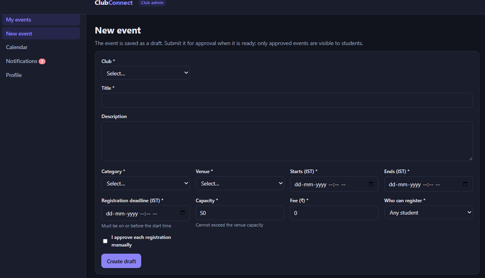

**Screenshot: Campus admin: all events and approval status**

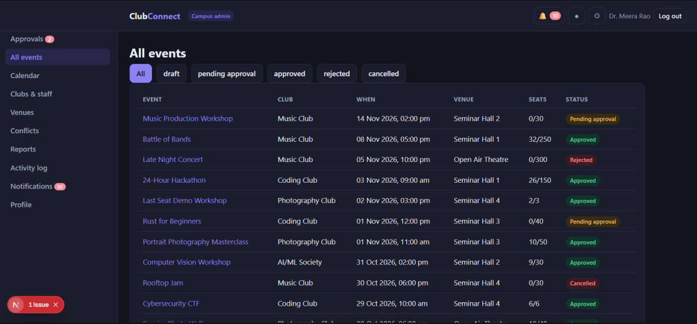

**Screenshot: Campus admin: reports**

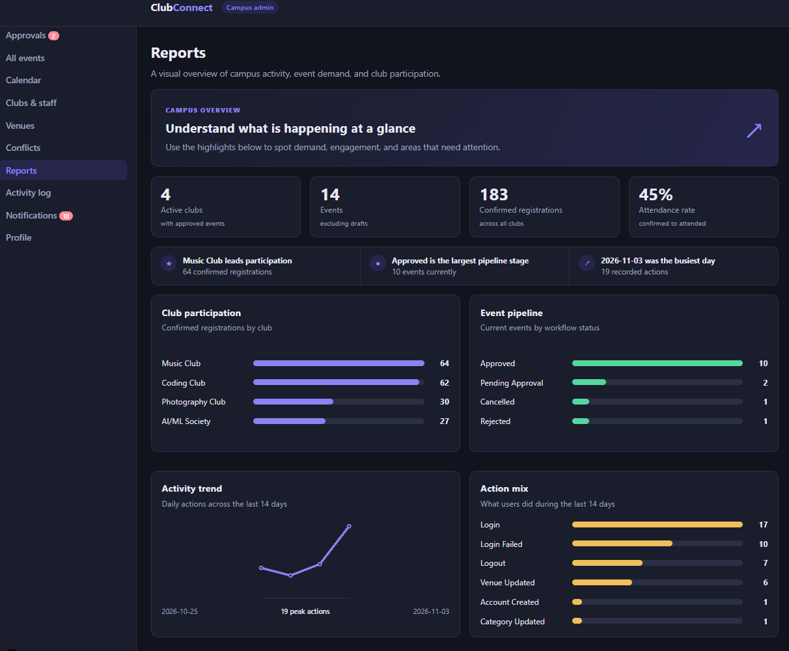

---

## 7. Getting started

### Prerequisites
- Node.js **20.12+** (built with 22) and npm
- PostgreSQL **15+** (built with 16) and a superuser that can create roles and the `btree_gist` extension
- MongoDB **6, 7 or 8** running locally (default `mongodb://localhost:27017`)

### Install and configure
```bash
git clone <repo-url> clubconnect && cd clubconnect
npm install
createdb -U postgres clubconnect          # or: psql -U postgres -c "CREATE DATABASE clubconnect"
cp .env.example .env                      # Windows: copy .env.example .env
```
Edit `.env`:

| Variable | Meaning |
|---|---|
| `DATABASE_URL_ADMIN` | Owner/superuser connection, used only by migrations and seeds |
| `DB_APP_PASSWORD` and `DATABASE_URL` | Password and connection string of the restricted `clubconnect_app` login (use the same password in both) |
| `MONGODB_URI`, `MONGODB_DB` | MongoDB connection and database name |
| `SESSION_SECRET` | Random string, at least 32 characters (`openssl rand -base64 48`) |

Never commit `.env`.

### Create and seed the databases
```bash
npm run db:migrate     # PostgreSQL schema, functions, triggers, views, roles, RLS
npm run db:seed        # demo data
npm run mongo:init     # MongoDB collections, validators, indexes
npm run mongo:seed     # MongoDB demo data
```
(`npm run db:setup` runs all four, but it uses `&&`, which Windows PowerShell 5 rejects. Run the commands one by one there.)

Reset demo data at any time: `node scripts/seed.mjs --reset`.

### Run
```bash
npm run dev            # http://localhost:3000
# or a production build
npm run build && npm start
```
`next start` marks the session cookie `Secure`; Safari may reject that on `localhost`, so use `npm run dev` there.

### Explore the SQL directly
```bash
psql -U postgres -d clubconnect -f db/demo/01_ddl.sql      # DDL, constraint violations
psql -U postgres -d clubconnect -f db/demo/02_dml.sql      # INSERT/UPDATE/DELETE/UPSERT (rolled back)
psql -U postgres -d clubconnect -f db/demo/03_queries.sql  # joins, nested, correlated, recursive CTE, windows
psql -U postgres -d clubconnect -f db/demo/04_advanced.sql # functions, triggers, locking, exclusion, EXPLAIN
psql -U postgres -d clubconnect -f db/demo/05_rbac.sql     # roles, GRANTs, row-level security
```
Captured real output of each script is in `docs/outputs/`.

---

## 8. Demo accounts and demo script

Password for all demo accounts: `Password@123` (**development seed only**).

| Role | E-mail |
|---|---|
| Campus admin | `admin@pes.edu` |
| Club admin | `ca.coding@pes.edu` (Coding Club + AI/ML Society), `ca.music@pes.edu`, `ca.photo@pes.edu` |
| Student | `aarav.sharma1@stu.pes.edu` (40 students exist) |

Seeded scenarios worth showing: **Rust for Beginners** overlaps *Portrait Photography Masterclass* in Seminar Hall A (approval is refused); **Cybersecurity CTF** is full; **Last Seat Demo Workshop** has one seat left; **Computer Vision Workshop** is members-only with manual approval and has pending registrations; **Old Hall** is inactive.

Five-minute walkthrough:
1. Club admin creates a draft and submits it.
2. Campus admin sees the clash warning, tries to approve the clashing event (refused by the database), approves a non-clashing one.
3. Student finds the event (search, filter, calendar) and registers; the full event is refused.
4. Club admin approves a pending registration, marks attendance, posts an announcement (MongoDB).
5. Campus admin opens **Reports** (SQL + MongoDB) and the **Activity log**; run `db/demo/05_rbac.sql` to show row-level security.

---

## 9. Testing and verification

```bash
npm run test:db      # database suite
npm run test:mongo   # MongoDB suite
node scripts/seed.mjs --reset && npm run test:api   # end-to-end over HTTP (app must be running)
```

| Suite | Result | Covers |
|---|---|---|
| Database (`docs/test-results-db.md`) | **50 / 50 pass** | constraints, triggers, exclusion constraint, RBAC/RLS, full lifecycle, concurrency (5 parallel clients for 1 seat → 1 winner) plus a *negative control* that deliberately omits the lock and over-books |
| API / end to end (`docs/test-results-api.md`) | **52 / 52 pass** | authentication, role checks, the full workflow, validation, SQL-injection input, CSRF, **8 HTTP clients racing for the last seat → exactly 1 wins**, PostgreSQL stop/restart (503 and recovery), every page renders |
| MongoDB (`docs/test-results-mongo.md`) | **13 pass, 5 partial, 2 skipped, 0 failed** | CRUD, upsert, unique index, validation, failure handling |

**Honest limits.** The MongoDB tests ran on a MongoDB-compatible test server. The 5 *partial* results are aggregation pipelines checked against manual calculations but evaluated in memory (`mingo`); the 2 *skipped* ones are the `$jsonSchema` validator and the TTL index, which that server does not implement. Run `npm run mongo:init` (without `MONGO_COMPAT_MODE`) and `npm run test:mongo` on real MongoDB to close this gap. See `docs/05-testing.md`.

---

## 10. Evaluation rubric mapping

| # | Criterion | Where to look |
|---|---|---|
| 1 | Database design: ER diagram, relational schema, keys and constraints | `docs/02-er-and-relational-schema.md`, `docs/images/` |
| 2 | Database creation: SQL DDL with constraints, NoSQL creation, technology justification | `db/migrations/001–006`, `db/demo/01_ddl.sql`, `scripts/mongo-init.mjs`, `src/lib/mongo-schema.mjs`, `docs/04-architecture-and-security.md` §1 |
| 3 | SQL operations and queries: DML, nested/correlated/recursive, joins | `db/demo/02_dml.sql`, `db/demo/03_queries.sql`, `docs/outputs/` |
| 4 | Advanced concepts: function, trigger, CTE; NoSQL read/update/delete | `002_functions_triggers.sql`, `003_views_indexes.sql`, `db/demo/04_advanced.sql`, `src/lib/mongo.ts` |
| 5 | Web application and database integration | `src/app/` (3 role areas), `src/app/api/` (REST API), `src/lib/` |
| 6 | Authentication and authorization: 2+ roles, RBAC in the database | `004_roles_rls.sql`, `src/lib/session.ts`, `src/lib/db.ts`, `docs/outputs/05_rbac.txt` |
| 7 | Documentation, Git/GitHub, demonstration, testing, originality | `docs/`, this README, `docs/test-results-*.md`, `docs/07-viva-guide.md`, `docs/08-contributions.md` |

---

## 11. Project structure

```
db/
  migrations/   001 schema · 002 functions+triggers · 003 views+indexes · 004 roles+RLS
                005 session check · 006 student visibility of cancelled events
  demo/         SQL demonstration scripts (DDL, DML, queries, advanced, RBAC)
scripts/        migrate, seed, mongo-init, mongo-seed, test-db, test-mongo, test-api
src/
  app/          pages: student/ club/ campus/ login register · REST API in api/
  components/   shared UI (calendar, forms, tables, shell)
  lib/          db.ts (role switching), session.ts, auth.ts, api.ts (error mapping),
                validation.ts (Zod), queries.ts, reports.ts, mongo.ts, mongo-schema.mjs,
                mongo-pipelines.mjs, ratelimit.ts
docs/           requirements tracker, ER + schema, Mongo model, architecture + security,
                testing, decisions, viva guide, contributions, test results, outputs, images
```

---

## 12. Design decisions, limitations and future work

**Decisions** (`docs/06-deviations-and-decisions.md`)
- One role per account (three separate account types).
- `event_schedules` merged into `events` (one schedule per event).
- Simplified statuses: events DRAFT → PENDING_APPROVAL → APPROVED / REJECTED / CANCELLED; registrations PENDING / CONFIRMED / REJECTED / CANCELLED.
- Notifications stay in PostgreSQL (created by triggers in the same transaction).

**Known limitations**
- Real-MongoDB validators, TTL and server-side aggregation not yet verified (see §9).
- Login throttle is in memory, per process.
- No e-mail verification, password reset or MFA.
- Demo accounts share a password; development PostgreSQL used `trust` authentication. For production use `scram-sha-256`, TLS, and never seed demo accounts.
- Only Chromium was checked for the UI.

**Future work (deferred on purpose)**: payments and refunds, waitlist, QR-code attendance, co-organisers (`event_organizers`), e-mail notifications, password reset and MFA, a distributed rate limiter.

---

## 13. Team contributions and declaration

| Team member | Contribution |
|---|---|
| **Dhriti Kamani** (PES1UG24AM085) | MongoDB design, SQL schema, UI, reports, integration, testing |
| **Disha Lokesh** (PES1UG24AM093) | ER design, Next.js interface, triggers/functions, API |

**Original contribution (novelty):** ClubConnect is a single platform that takes a campus club event through its whole life: a club proposes an event, the campus approves it, students register, and attendance is recorded. It replaces the chat groups, spreadsheets and e-mail threads clubs rely on today. Three kinds of users (Student, Club Admin, Campus Admin) work in one system, and each sees only what their role allows. That is enforced inside the database, not only in the interface. Scheduling clashes are caught before they become a problem. A club admin gets a venue-clash warning while preparing an event, and the database refuses to approve two events that overlap in the same venue. Back-to-back events are still allowed.

The club admin workspace is built around the real workflow of running an event. An event starts as an editable draft, is submitted for approval, and becomes read-only once submitted (a database trigger enforces this). Admins can withdraw a pending event, or reopen a rejected one to fix it and resubmit. Each event can be open to everyone or to club members only, with optional manual approval, so the club decides who gets in. Admins approve or reject pending registrations, mark attendance only for confirmed registrations and only after the event has started, and post pinned announcements to participants. They read student feedback anonymously, and cancelling an event automatically cancels every live registration and notifies the affected students. One admin account can manage several clubs, but cannot touch another club's data or approve their own event, because the database withholds that permission.

